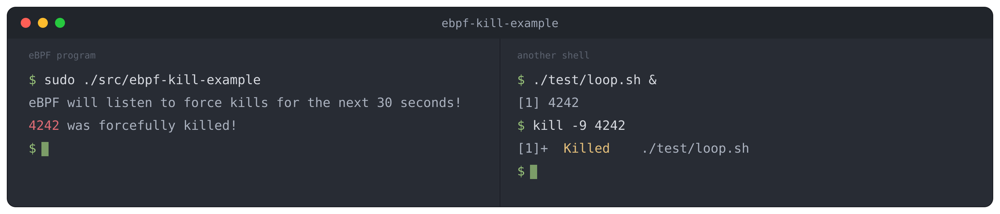

# ebpf-kill-example

[](https://github.com/niclashedam/ebpf-kill-example/actions/workflows/default.yml)

*ebpf-kill-example* is an example of an eBPF program hooking into the kill tracepoint.
This project is a Proof-of-Concept (PoC) showing the feasibility and viability of eBPF.
Furthermore, the project shows how to create and run a simple eBPF program.

## How it works

The eBPF program in [`src/kern.c`](src/kern.c) attaches to the `sys_enter_kill`
tracepoint, so it runs inside the kernel every time a process calls `kill()`.
When the signal is `SIGKILL` (a `kill -9`), it records the target PID in a BPF
hash map. All other signals are ignored.

The loader in [`src/user.c`](src/user.c) loads that program into the kernel,
attaches it, and waits 30 seconds. It then reads the hash map, which is shared
between kernel and user space, and prints every PID that was force-killed during
that window.

For background on eBPF itself, see [What is eBPF?](docs/what-is-ebpf.md).

## Minimum requirements

To run this example, the following software is required.

- **Linux kernel v4.19+**
- **LLVM 10+**
- libelf-dev (Installed via *make deps*)
- zlib1g-dev (Installed via *make deps*)
- gcc-multilib (Installed via *make deps*)

Alternatively, you can build and run everything with [Docker](#docker), which
needs nothing installed beyond Docker itself. This is the easiest way to try
the example on non-Linux hosts (e.g. macOS), or on architectures where
*gcc-multilib* is not available, such as arm64.

## Installation

To install ebpf-kill-example, first clone this repository.

```
git clone https://github.com/niclashedam/ebpf-kill-example
```

Install dependencies needed to compile *ebpf-kill-example*.

```
make deps
```

Compile *ebpf-kill-example*.

```
make
```

## Usage

Run *ebpf-kill-example*. Super user privileges are required to load the program into the kernel.

```
sudo ./src/ebpf-kill-example
```

## Test

To test *ebpf-kill-example*, run `make test`.
This will load the eBPF program, start a looping process and kill it. It will
verify that the eBPF program was invoked when kill was called.

```
$ make test
./test/test.sh
-- Loading eBPF program.
-- Starting test process to kill.
-- PID of test process is 4242.
-- Killed. Waiting for eBPF program to terminate ..
[ OK ] -- eBPF program ran as expected.
```

## Docker

A `Dockerfile` is provided for a reproducible build and test environment that
does not depend on your host setup. This is handy on non-Linux hosts or when
you would rather not install the toolchain locally.

Build the image:

```
docker build -t ebpf-kill-example .
```

Build and run the test. The eBPF program is loaded into the kernel and attached
to a tracepoint, so `--privileged` is required (the container mounts tracefs so
the tracepoint is reachable):

```
docker run --rm --privileged ebpf-kill-example
```

On Docker Desktop (macOS/Windows) the container runs against the Docker VM's
Linux kernel, so a Linux host is not required.

## Example


## Contributing
Pull requests are welcome. For major changes, please open an issue first to discuss what you would like to change.

Please make sure to update tests as appropriate.

## License
[GPLv3](https://choosealicense.com/licenses/gpl-3.0/)
